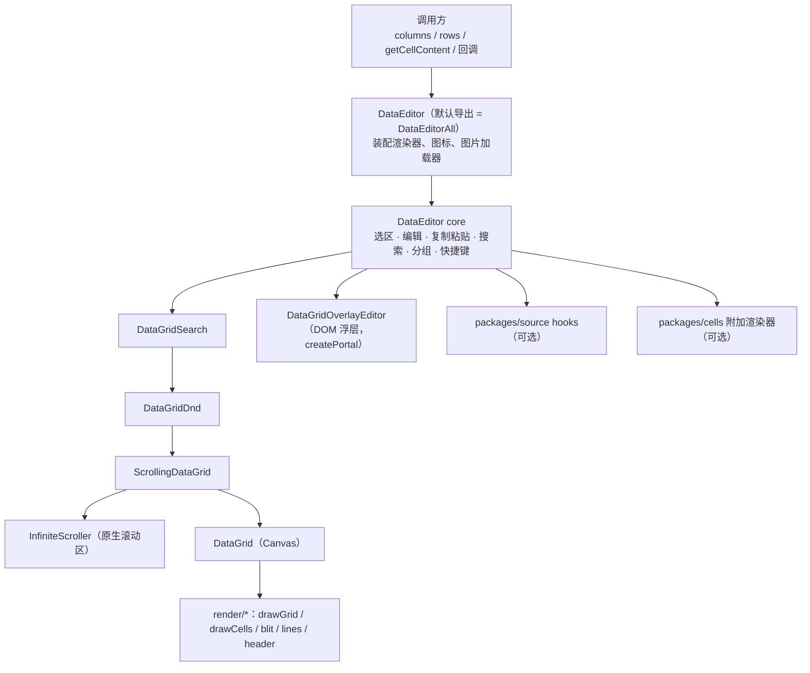

# Glide Data Grid 深度解构报告

> 分析对象：`/Users/zhouguiqing/Documents/Code/Html/glide-data-grid`
> 版本：`v6.0.4-alpha25`（HEAD `0875d78c`，工作区干净，与 `origin/main` 同步）
> 许可：MIT ｜ 技术栈：React 16–19 + TypeScript + HTML Canvas
> 分析日期：2026-11-20
> 文中行号均相对上述仓库根目录，例如 `packages/core/src/...:123`。

---

## 0. 一页速览

Glide Data Grid 是一个**用 Canvas 替代 DOM 虚拟化的大数据表格**：数据由调用方通过 `getCellContent([col,row])` 按需提供，组件只渲染当前视口，依靠浏览器原生滚动 + 像素级画布搬移（blit）实现"百万行、滚动流畅"。

三个最关键的结论：

1. **数据完全外部化，交互状态内部化。** `rows` / `columns` / `getCellContent` 必填且归调用方所有；选区、编辑浮层、拖拽、搜索显隐、可见区等归组件内部管理（`packages/core/src/data-editor/data-editor.tsx:205-699, 773-1200`）。
2. **性能核心不是"虚拟 DOM"，而是"尽量不画"。** 完整帧短路 → 脏区 damage → 单向像素 blit → 双缓冲 → 局部重画，逐层减少绘制量（`packages/core/src/internal/data-grid/render/data-grid-render.ts:170-793`）。
3. **扩展契约清晰但 Canvas 限定。** 12 种公开 `GridCellKind` + 公开 `CustomRenderer` 接口；自定义单元格必须用 Canvas 绘制，`cells` 包额外提供 13 种可复用类型。

```
npm i @glideapps/glide-data-grid
import "@glideapps/glide-data-grid/dist/index.css";
<DataEditor getCellContent={getData} columns={columns} rows={numRows} />
```

---

## 1. 仓库结构与包职责

根目录是 npm workspaces 单仓（`package.json:25-29`），三个工作区统一版本 `6.0.4-alpha25`：

| 包 | 目录 | npm 名称 | 职责 |
| --- | --- | --- | --- |
| core | `packages/core` | `@glideapps/glide-data-grid` | 主包：DataEditor、Canvas 渲染、选区/编辑/搜索/分组/复制粘贴、12 种内置单元格 |
| cells | `packages/cells` | `@glideapps/glide-data-grid-cells` | 13 种附加单元格（下拉、多选、日期、星级、树形、富文本等） |
| source | `packages/source` | `@glideapps/glide-data-grid-source` | 5 个数据源 hooks（异步分页、排序、折叠分组、列移动、撤销重做） |

其他重要目录：

- `packages/core/API.md`（1466 行）：完整 API 参考。
- `packages/core/src/docs/*.stories.tsx`、`packages/core/src/stories/`、`packages/cells/src/cell.stories.tsx`：Storybook 示例与文档。
- `.storybook/`：Storybook 9 配置（vite + docs + Linaria 插件）；`preview-body.html` 注入 `<div id="portal">`。
- `config/build-util.sh`：三个包共用的编译流水线。
- `test-projects/`：CRA5、Next.js 真实脚手架消费测试（软链本地 core）。
- `setup-react-18-test.sh` / `setup-react-19-test.sh`：React 大版本兼容测试脚本。
- `.github/workflows/`：CI、tag 驱动的 npm 发布、Storybook 部署。

### 1.1 分层图



代码分层自顶向下对应：

- `data-editor-all.tsx`（薄包装，约 36 行）
- `data-editor/data-editor.tsx`（核心，4346 行）
- `internal/data-grid-search/`、`internal/data-grid-dnd/`、`internal/scrolling-data-grid/`
- `internal/data-grid/data-grid.tsx`（1949 行）+ `internal/data-grid/render/*`
- `internal/data-grid-overlay-editor/*`（编辑态 DOM）

### 1.2 两个导出入口

`packages/core/src/index.ts:49-54,87`：

- `DataEditor`（默认导出）= `DataEditorAll`：开箱即用。
- `DataEditorCore` = 裸 `DataEditor`：不注入任何渲染器、图标、图片加载器，需自行提供。

`DataEditorAll` 只做三件事（`data-editor-all.tsx:13-25`）：

```tsx
headerIcons = { ...sprites, ...p.headerIcons }          // 内置图标 + 自定义
renderers   = p.renderers ?? AllCellRenderers           // 默认全部内置渲染器
imageWindowLoader = p.imageWindowLoader ?? new ImageWindowLoaderImpl()
```

---

## 2. 公共 API 的形状

`DataEditorProps` 定义于 `data-editor.tsx:205-699`，继承并 `Partial` 化了底层 `DataGridProps` / `DataGridSearchProps`。**必填只有三个**（`:286, :318, :546`）：

```ts
columns: readonly GridColumn[];
rows: number;
getCellContent: (cell: Item) => GridCell;   // Item = readonly [col, row]
```

其余按职责可归纳为：

| 分类 | 关键 props | 源码位置 |
| --- | --- | --- |
| 数据 | `getCellsForSelection`、`getRowThemeOverride`、`getGroupDetails` | `:604, :473, :1401` |
| 选区 | `gridSelection`、`onGridSelectionChange`、`rangeSelect`、`columnSelect`、`rowSelect`、`rangeSelectionBlending` | `:500, :510, :393-409` |
| 编辑 | `onCellEdited`、`onCellsEdited`、`onDelete`、`onRowAppended`、`validateCell`、`provideEditor`、`editOnType`、`coercePasteValue` | `:209-277, :478, :581` |
| 搜索 | `showSearch`、`searchValue`、`onSearchValueChange`、`searchResults`、`onSearchResultsChanged` | `data-grid-search.tsx:53-89` |
| 样式 | `theme`、`rowHeight`、`headerHeight`、`freezeColumns`、`rowMarkers`、`scaleToRem`、`verticalBorder` | `:307-444, :611-657` |
| 拖放 | `onRowMoved`、`onColumnMoved`、`onColumnResize/Start/End`、`onDrop` 等 | `internal/data-grid-dnd/data-grid-dnd.tsx:13-80` |
| 高级 | `renderers`、`customRenderers`、`rowGrouping`、`portalElementRef`、`experimental`、`drawCell`、`drawHeader` | `:645-698` |

### 2.1 DataEditorRef 命令式方法

定义 `data-editor.tsx:715-760`，实现 `:3996-4121`，全部对行标记伪列做 `±rowMarkerOffset` 修正：

| 方法 | 实现 | 作用 |
| --- | --- | --- |
| `appendRow(col, openOverlay?)` | `:1687-1742` | 调 `onRowAppended`，指数退避等待 `rows` 增长，滚动到新行，可自动打开编辑器 |
| `appendColumn(row, openOverlay?)` | `:1744-1793` | 同上，针对列 |
| `updateCells(damageList)` | `:4001-4006` | 局部失效重绘，避免整表重绘 |
| `getBounds(col?, row?)` | `:4007-4024` | 获取滚动区或单元格屏幕坐标 |
| `focus()` / `scrollTo(...)` | `:4025, :1524-1673` | 聚焦 / 按单元格或像素滚动 |
| `emit(eventName)` | `:4026-4083` | 触发 delete / fill-right / fill-down / copy / paste |
| `remeasureColumns(cols)` | `:4085-4089` | 重新测量自然列宽并重发 resize 事件 |
| `getMouseArgsForPosition(x,y,ev?)` | `:4090-4108` | 对外暴露命中测试 |

---

## 3. 数据模型与核心类型

| 类型 | 定义位置 | 要点 |
| --- | --- | --- |
| `Item = readonly [col, row]` | `internal/data-grid/data-grid-types.ts:146` | 坐标永远是 `[列, 行]`，不是 `[行, 列]`；`row=-1` 表头，`row=-2` 分组表头 |
| `GridCellKind` | `data-grid-types.ts:79-92` | 12 个公开值：`Uri/Text/Image/RowID/Number/Bubble/Boolean/Loading/Markdown/Drilldown/Protected/Custom` |
| `InnerGridCellKind` | `data-grid-types.ts:497-500` | 内部：`NewRow`、`Marker` |
| `GridSelection` | `data-grid-types.ts:17-25` | `current`（cell/range/rangeStack）+ `columns` + `rows` |
| `CompactSelection` | `data-grid-types.ts:590-710` | 不可变区间集合，内部合并为半开区间 `[start,end)` |
| `GridCell.span` | `data-grid-types.ts:316` | 合并单元格 `[startCol, endCol]` |
| `Theme` / `FullTheme` | `common/styles.ts:57-101, 153-157` | 约 40 个扁平字段；`FullTheme` 补齐解析后的字体信息 |
| `DrawGridArg` | `render/draw-grid-arg.ts:30-83` | 一帧渲染所需的全部参数 |
| `BlitData` | `render/data-grid-render.blit.ts:9-19` | 上一帧滚动位置、buffer 选择等 |
| `CellSet` | `internal/data-grid/cell-set.ts:4-65` | 以整数打包 `(col,row)` 的脏单元格集合 |
| `BaseDrawArgs` / `DrawArgs` | `cells/cell-types.ts:16-31, 37-43` | 绘制上下文、主题、rect、hover 状态、动画请求等 |
| `CustomRenderer` / `InternalCellRenderer` | `cells/cell-types.ts:97-121` | 自定义/内置渲染器契约 |

主题覆盖优先级（由窄到宽）：单元格/列 `themeOverride` → `getRowThemeOverride` → 尾部新增行主题 → DataEditor 顶层 `theme`。`mergeAndRealizeTheme`（`common/styles.ts:171-214`）逐层合并并重算字体与半透明底色；`makeCSSStyle`（`:7-54`）把主题投影为 `--gdg-*` CSS 变量供 DOM 浮层使用。

---

## 4. 渲染管线：一帧是怎么画出来的

### 4.1 触发源

`draw()`（`data-grid.tsx:768-916`）是唯一重绘入口，它组装 `DrawGridArg` 后调用 `drawGrid(current, last)`（`:859-864`）。触发源：

| 触发 | 位置 |
| --- | --- |
| props 变化（`useLayoutEffect([draw])`） | `data-grid.tsx:918-922` |
| 字体加载完成 → 清空上一帧参数强制全量重绘 | `:924-932` |
| Sprite 异步解码完成 | `:426-433` |
| 数据变更（ref 的 `damage()`） | `:934-938` |
| 图片加载完成（注入 `damageInternal` 回调） | `:950` |
| 动画队列逐帧 damage | `use-animation-queue.ts:14-30` |
| hover 淡入淡出（80ms，`easeOutCubic`） | `animation-manager.ts:9, 67-94` |

一个刻意设计：damage 绘制给 `drawGrid` 传 `lastArg = undefined` 绕过"无变化短路"，但用 damage 区域限制绘制范围（`data-grid.tsx:852-864`）。

### 4.2 `drawGrid` 的 19 个阶段

核心实现 `render/data-grid-render.ts:115-797`，按顺序：

1. **准入与 DPR**：宽高为 0 直接返回；`dpr = min(maxScaleFactor, ceil(devicePixelRatio))`（`:170-175`）。`maxDPR` 默认 5；实验性 Firefox/Safari 滚动降采样时分别为 1 / 2（`data-grid.tsx:437-450, 761`）。
2. **计算 `canBlit`**：`computeCanBlit(arg, lastArg)`（`:175`，实现见 `blit.ts:233-291`）。
3. **同步画布尺寸**：主 canvas、表头 canvas、双缓冲 A/B 仅在尺寸变化时重设（`:177-212`）；重设会清屏，因此同时作废 buffer 的滚动记录。
4. **完全无变化短路**：`canBlit === true` 且 `cellXOffset/cellYOffset/translateX/translateY` 全等于上一帧 → 直接 `return`（`:214-222`）。
5. **选目标 context**：单缓冲直接画主 canvas；双缓冲选 A/B 之一作为 target，另一块为 blitSource（`:224-238`）。
6. **计算有效列**：`getEffectiveColumns` 保留冻结列并从 `cellXOffset` 累加列宽到覆盖视口（`:256`，实现 `data-grid-lib.ts:205-246`）。
7. **表头重绘判定**：焦点环 / 高亮环落在表头行才重画表头纹理（`:260-365`）。
8. **damage 快速路径**（`:367-504`）：判断脏区是否落在表头两行、可视行、冻结列、冻结尾行这 5 类区域；命中则只执行 `doDamage`（内部 `drawCells` + 填充柄 + 裁剪），双缓冲同步写到主 canvas，然后**直接 return**。这是避免大 blit 与大范围重画的关键分支。
9. **表头条件重绘**：仅水平滚动或焦点/高亮状态变化时重画（`:506-514`）。
10. **blit**：`blitLastFrame` 或单列宽度变化的 `blitResizedCol`，返回需要真正重画的 `drawRegions`（`:516-555`）。
11. **重画冻结边界线**：blit 会搬走分割线，需 overdraw（`:557-567`；`lines.ts:107-147`）。
12. **准备延迟绘制闭包**：焦点环 / 高亮环 / 填充柄在 blit 后补画（`:569-609`）。
13. **背景填充**：只对 `drawRegions` 做 `clip + fill`；否则整屏填充（`:611-622`）。
14. **单元格主体** `drawCells`（`:624-660`）→ 返回合并单元格 spans。
15. **空白区 / 行主题溢出 / 网格线**：`drawBlanks` → `drawExtraRowThemes` → `drawGridLines(spans)`（`:662-720`）。
16. **补画环与填充柄**（`:722-723`）。
17. **列宽拖拽指示线**（`:725-748`）。
18. **双缓冲合成**：`mainCtx.fillRect` + `drawImage(targetCtx.canvas)`（`:750-754`）。
19. **更新图片窗口**：`imageLoader.setWindow(...)` 只加载真正可见行（`:756-778`），随后记录 `lastBlitData`（`:780-793`）。

### 4.3 blit 与双缓冲

- 渲染策略默认：Safari 使用 `"double-buffer"`，其他浏览器 `"single-buffer"`，可由 `experimental.renderStrategy` 覆盖（`data-grid.tsx:846`）。离屏 canvas 挂在 `document.documentElement`，`display:none`（`:737-757`）。
- `computeCanBlit` 比对 18 个字段（宽高、主题、行高、选区、`getCellContent` 等）；列集合引用变化时，只有在列数 ≤100 且**恰好一列宽度改变**才返回列索引用于增量 blit，否则放弃（`blit.ts:233-291`）。
- `blitLastFrame`：按可变行高累加算 `deltaY`、按列宽累加算 `deltaX`（`blit.ts:47-71`）；**斜向滚动直接放弃 blit**（`:75-79`）；有效区域需 >150×150px（`:84-87`）；只做单向 `drawImage` 搬移（`:99-155`），`imageSmoothingEnabled = false` 保证像素精确；双缓冲时还要额外搬运冻结列/尾行（`:158-182`）。
- `blitResizedCol`：列宽变化只重画该列右侧条带（`:193-231`）。

### 4.4 动画与局部失效

`useAnimationQueue`（`use-animation-queue.ts:8-41`）用 `packColRowToNumber(col,row)` 存整数并去重；首帧启动 rAF，每帧把队列解包为 `CellSet` 交给 `draw`；长动画 `seq > 600` 时额外降频一帧。`AnimationManager`（`animation-manager.ts:16-119`）驱动 hover 淡入淡出，仅在 renderer 声明 `needsHover` 时启用（`data-grid.tsx:1276-1288`）。单元格 renderer 通过 `requestAnimationFrame(state?)` 申请持续帧（如 spinner 单元格 `packages/cells/src/cells/spinner-cell.tsx:28`）。

### 4.5 视口、冻结与合并单元格

- **可见区**：`ScrollingDataGrid.processArgs`（`internal/scrolling-data-grid/scrolling-data-grid.tsx:121-240`）把 DOM 滚动坐标换算为 `cellX/cellY + tx/ty`；固定行高直接除，可变行高逐行累加（`:162-195`）；`smoothScrollX/Y` 决定整格对齐还是像素偏移（`:145-149, 163-168`）。`DataEditor.onVisibleRegionChangedImpl`（`data-editor.tsx:2584-2657`）再补上行标记偏移与冻结区信息。
- **冻结列/尾行**：`useMappedColumns` 给 `i < freezeColumns` 打 `sticky` 标记（`data-grid-lib.ts:22-55`）；绘制、命中、blit 均有 sticky 分支。
- **可变行高**：`rowHeight: number | ((row:number)=>number)`（`data-grid.tsx:108`）；所有高度累加统一走 `getRowHeight`，覆盖滚动、blit、行遍历、命中测试。
- **合并单元格**：`drawCells` 用 `handledSpans` Set 保证跨列只画一次（`render/data-grid-render.cells.ts:226-262`）；返回的 `spans` 传给 `drawGridLines`，用 `ctx.clip("evenodd")` 一次排除内部网格线（`render/data-grid-render.lines.ts:299-307`）。

---

## 5. 滚动、命中测试与选择

### 5.1 原生滚动层

组件树：`ScrollingDataGrid` → `InfiniteScroller` → `DataGridDnd` → `DataGrid`（`scrolling-data-grid.tsx:254-345`）。

- `.dvn-scroller` 用原生 `overflow:auto` + `translate3d(0,0,0)`；canvas 位于 `.dvn-underlay`，滚动内层 `pointer-events:none`（`infinite-scroller.tsx:30-62`）。
- 真正撑出滚动条的是不可见 padder；浏览器最大 div 高度 `33,554,400`，按每段最多 `5,000,000` 分段（`infinite-scroller.tsx:74, 82, 316-324`）。
- 大跳变滚动按比例换算虚拟 Y，平滑滚动累加 delta（`:249-269`）；`overscrollX/Y` 直接加进 scrollWidth/Height（`scrolling-data-grid.tsx:105, 115-117`）。
- Safari 的 `kineticScrollPerfHack`：`touchend` 后以约 120Hz 轮询 `scrollTop`，连续 10 帧不变才停止（`use-kinetic-scroll.ts:22-74`）。
- 滚动闭环：`onScroll` → `update()` → `processArgs()` → `onVisibleRegionChanged` → DataEditor 更新 `visibleRegion` → 新的 `cellXOffset/YOffset/tx/ty` props → `draw()` 的 `useLayoutEffect` 重绘（`scrolling-data-grid.tsx:277-283, 242-248`；`data-grid.tsx:918-922`）。

### 5.2 命中测试

`getMouseArgsForPosition`（`data-grid.tsx:516-727`）是唯一的坐标→语义转换入口：

1. scale 校正（`:523-526`）；
2. `getEffectiveColumns` + `getColumnIndexForX`（`:529, 548`；实现 `data-grid-lib.ts:248-262`）；
3. `getRowIndexForY` 处理可变行高与冻结尾行（`:552-563`；`data-grid-lib.ts:264-306`）；
4. 输出三类事件：越界（含是否边缘/滚动条，`:574-612`）、表头/分组表头（`:613-656`）、单元格（含填充柄命中，`:657-705`）。

表头小部件（图标、菜单、分组 action）另有 `isOverHeaderElement` / `groupHeaderActionForEvent`（`:1004-1071`）。事件监听包括 pointerdown/up/click/contextmenu/move/drag 等（`:1076-1674`）；hover 通过比较事件参数与 `needsHoverPosition` 条件短路，避免不必要的 setState 与重绘（`:1308-1350`）。

### 5.3 选区与填充柄

- 状态中枢：`setGridSelection`（`data-editor.tsx:997-1016`）→ `expandSelection`（`data-editor-fns.ts:5-98`，把 range 扩到完整 span）→ 受控则回调 `onGridSelectionChange`，否则写 `gridSelectionInner`。
- 选择行为 hook `useSelectionBehavior`（`use-selection-behavior.ts:16-152`）实现 `exclusive/mixed/additive` 三种 blending 与 `rangeStack` 追加；点击/Shift/Ctrl 逻辑在 `data-editor.tsx:1838-2087`，拖拽框选在 `:2728-2824`，键盘扩选在 `:2854-3019`。
- 填充柄：`onMouseDown` 记录 fillHandle（`:2116-2123`）→ hover 时 `getClosestRect` 算预览区并画虚线（`:2765-2769, 1266-1272`）→ mouseup 时 `combineRects` + `fillPattern`（`:2245-2296`）：按取模映射生成 `EditListItem[]`，先发可取消的 `onFillPattern`，再批量编辑并 damage。`fillRight`/`fillDown` 复用同一路径（`:2298-2330`）。

---

## 6. 交互状态流：从用户操作到数据落地

### 6.1 组件状态构成

**没有 useReducer**，全部是 `useState` + 大量 `useRef`（ref 保存最新值，规避异步回调的陈旧闭包）：

- `useState`：`gridSelectionInner`（`:774`）、`overlay`（`:776-785`）、`mouseState`（`:788`）、`showSearchInner`（`:958`）、`clientSize`（`:1096`）、`fillHighlightRegion`（`:1227`）、`renameGroup`（`:2135`）、`scrollDir`（`:2243`）、`isFocused`（`:4151`）。
- 关键 `ref`：`getCellContentRef`（`:1675-1679`）、`rowsRef/colsRef`（`:1681-1685`）、`visibleRegionRef`（`:1171`）、`gridRef`（`:1193`）、`lastSelectedRow/Col`（`:1818-1819`）、`mouseDownData`（`:2091`）、`abortControllerRef`（`:974`）。

### 6.2 `getCellContent` 的桥接

外部函数不会直接传给 Canvas，而是经 `getMangledCellContent`（`data-editor.tsx:1309-1399`）包装，负责：

- 行标记伪列的坐标偏移（`:1313-1328`）；
- 尾部新增行（`:1329-1347`）；
- 严格模式下只暴露可见区数据（`:1350-1372`）；
- span 起点映射（`:1374-1379`）；
- 最终调用外部 `getCellContent([outerCol, row])`（`:1373`）。

批量取数由 `useCellsForSelection`（`use-cells-for-selection.ts:7-72`）负责，供复制、搜索、自动列宽、span 展开共用。

### 6.3 编辑一次单元格的完整链路

```
激活（单击/双击/回车/直接输入）
  → onCellActivated
  → reselect(cell, activationEvent, initialValue?)   :1445-1497
  → setOverlaySimple(合并 cell/column/row/group 主题)  :1428-1443
  → React.lazy 加载 DataGridOverlayEditor            :90-92, 4317-4335
  → createPortal 到 #portal 或 portalElementRef      overlay-editor.tsx:213-259
  → 用户输入 → validateCell（可判无效/改写值）        :94-110
  → Enter/Tab/Escape/clickOutside → onFinishEditing  :120-160
  → DataEditor.onFinishEditing                       :3084-3142
  → mangledOnCellsEdited                             :1207-1225
  → onCellsEdited（返回值 === true 表示已处理）；否则逐项 onCellEdited
  → rAF gridRef.current.damage() 局部重绘             :3088-3094
  → 调用方更新数据源 → getCellContent 返回新值
```

要点：

- 布尔单元格无浮层，点击复选框直接 `toggleBoolean`（`cells/boolean-cell.tsx:59-72`）。
- 浮层编辑器选择顺序：外部 `provideEditor(cellWithLocation)` → renderer 自带 `provideEditor`（`overlay-editor.tsx:164-173`）。
- 取消时 `newValue === undefined`，不触发任何数据回调，只关闭浮层。
- 末行/末列编辑后若配置了 append 回调，会自动追加新行/列并继续编辑（`:3099-3124`）。
- `useStayOnScreen`（`use-stay-on-screen.ts:13-61`）用 IntersectionObserver 防止浮层跑出视口。

### 6.4 其他交互模块

| 功能 | 实现要点 |
| --- | --- |
| 复制 | `onCopy`（`:3772-3875`）→ `copyToClipboard`（`data-editor-fns.ts:168-215`）→ `getCopyBufferContents`（`copy-paste.ts:223-237`）生成 text/plain + text/html（带 `gdg-raw-value` 属性）；依赖 `getCellsForSelection` |
| 粘贴 | `onPasteInternal`（`:3583-3765`）：剪贴板 HTML 优先 → `decodeHTML` → `readText` → `clipboardData`；`unquote` 拆 TSV；可由 `onPaste` 拦截；`coercePasteValue` 强制类型转换 |
| 剪切/删除 | `onCut`（`:3879-3906`）= 复制 + `deleteRange`；删除按 `range → rangeStack → rows → columns` 处理（`:3229-3265`） |
| 搜索 | `data-grid-search.tsx:165-274`：正则转义、stride=10 自适应（目标 10ms）、上限 1000 结果、AbortController；快捷键 Ctrl/Cmd+F / Esc / Enter；搜索只给结果，不直接改数据 |
| 行分组 | `data-editor/row-grouping.ts:73-178, 247-326`：展开/扁平化/索引映射；支持组头重命名与跨组选择限制（`:2708-2725`） |
| 列宽调整 | `use-column-sizer.ts:27-75, 78-253` 采样约 10 行 + renderer.measure；交互拖拽在 `data-grid-dnd.tsx:149-345`；新宽度必须由调用方写回 `columns` |
| 快捷键 | `data-editor-keybindings.ts:76-178` 默认值；`handleFixedKeybindings`（`data-editor.tsx:3188-3482`）逐项匹配；用户 `onKeyDown` 可先取消（`:3484-3545`） |

---

## 7. 单元格与扩展体系

### 7.1 core 内置渲染器（`packages/core/src/cells/index.ts:17-31`）

| Kind | 数据要点 | 可编辑 | 编辑方式 |
| --- | --- | --- | --- |
| `Text` | `data`, `displayData`, `readonly` | 是 | `GrowingEntry` 内联输入 |
| `Number` | `data: number`, 小数位/分隔符配置 | 是 | `NumberOverlayEditor`（react-number-format） |
| `Boolean` | `boolean \| null`，`allowOverlay:false` | 是 | 直接点击切换，无浮层 |
| `Bubble` | `data: string[]` | 否 | 纯展示浮层 |
| `Drilldown` | `{text, img?}[]` | 否 | 纯展示浮层 |
| `Image` | `data: string[]`, `rounding` | 部分 | `ImageOverlayEditor`，可 `imageEditorOverride` |
| `Uri` | `data`, `displayData`, `onClickUri` | 是 | 链接预览 + 铅笔切换编辑 |
| `Markdown` | `data: markdown string` | 是 | `MarkdownDiv` 预览 + 切换；可注入安全渲染器 |
| `Loading` | 骨架宽高与随机种子 | 否 | xorshift 伪随机骨架 |
| `Protected` | 仅 kind | 否 | 星形斜线遮蔽 |
| `RowID` | `data: string` | 基本只读 | 默认 disabled |
| `Custom` | `data: T`, `copyData: string` | 由 renderer 决定 | 由 renderer 的 `provideEditor` 决定 |

另有内部专用 `NewRow`（尾部新增行提示）和 `Marker`（行标记复选框），见 `cells/new-row-cell.tsx`、`cells/marker-cell.tsx`。

### 7.2 cells 包 13 种附加类型

均以 `GridCellKind.Custom` + `isMatch` 判别注册（`packages/cells/src/index.ts:16-63`）：

`StarCell`、`SparklineCell`、`SpinnerCell`、`TreeViewCell`、`UserProfileCell`、`TagsCell`、`DropdownCell`、`MultiSelectCell`、`LinksCell`、`RangeCell`、`DatePickerCell`、`ButtonCell`、`ArticleCell`（懒加载 Toast UI WYSIWYG）。

其中 `DropdownCell` / `MultiSelectCell` 依赖 `react-select`，`ArticleCell` 依赖 `@toast-ui/*`；`SpinnerCell` 通过持续 rAF 重绘实现动画。

### 7.3 自定义渲染器契约

`packages/core/src/cells/cell-types.ts`：

- `BaseCellRenderer<T>`（`:58-94`）：必填 `kind`、`draw`；可选 `needsHover`、`needsHoverPosition`、`measure`、`drawPrep`、`provideEditor`、`onClick`、`onSelect`、`onDelete`。
- `InternalCellRenderer<T>`（`:97-110`）：额外必填 `getAccessibilityString`、`onPaste`（返回**完整 cell**）。
- `CustomRenderer<T>`（`:113-116`）：额外必填 `isMatch(cell)`；`onPaste` 只返回 `T["data"]`。

注册与查找（`data-editor.tsx:1098-1115`）：非 Custom 走 `rendererMap[cell.kind]`；Custom 走 `additionalRenderers.find(r => r.isMatch(cell))`。

两种"半自定义"绘制钩子：

- `drawCell`：包裹默认内容绘制，可先画背景、调 `drawContent()`、再叠加（API.md:747-770）。
- `drawHeader`：返回 `boolean` 决定是否跳过默认表头绘制（API.md:774-795）；文档提醒过重的表头绘制会拖累横向滚动。

编辑器返回值支持三种形态（`data-grid-types.ts:402-424`）：组件本身 / `{editor, deletedValue?, styleOverride?, disablePadding?, disableStyling?}` / `undefined`。

### 7.4 packages/source：数据源 hooks

| Hook | 作用 | 源码 |
| --- | --- | --- |
| `useAsyncDataSource` | 服务端分页；未加载行返回 Loading；加载完 `updateCells` 局部刷新；并发控制与预取 | `use-async-data-source.ts:20-140` |
| `useColumnSort` | 客户端排序（default/raw/smart），按 kind 取值，Custom 取 `copyData` | `use-column-sort.ts:5-157` |
| `useCollapsingGroups` | 按 `column.group` 折叠列（压到 8px/36px） | `use-collapsing-groups.ts:14-136` |
| `useMoveableColumns` | 列拖拽重排（需把打乱后的 columns 回传调用方） | `use-movable-columns.ts:35-82` |
| `useUndoRedo` | reducer 管理撤销/重做栈，连续粘贴合并 batch，快捷键绑定 | `use-undo-redo.ts:46-241` |

---

## 8. 性能手段清单（可借鉴点）

| 手段 | 证据 |
| --- | --- |
| rAF 批量 damage + 整数 packed 去重 | `use-animation-queue.ts:14-40` |
| 滚动量完全不变时整帧短路 | `render/data-grid-render.ts:214-222` |
| 18 字段比对决定是否 blit；>100 列放弃深度比较 | `render/data-grid-render.blit.ts:233-291` |
| 单向像素 blit 替代重画；斜向滚动/小区域放弃 | `blit.ts:75-87, 99-183` |
| 列宽变化只重画右侧条带 | `blit.ts:193-231` |
| damage 快速路径 + 脏矩形 clip，只填新露区域 | `render/data-grid-render.ts:367-504, 611-622` |
| damage 逐 cell clip，避免一次传过多 clip | `render/data-grid-render.cells.ts:334-354` |
| 热循环避免对象分配；复用 `allocatedItem/reusableRect/drawState` | `cells.ts:184-215, 458-460, 502-511` |
| `PrepResult` 跨 cell 复用字体/填充色/渲染器，`ctx.font` 仅变化时赋值 | `cells.ts:114-169, 364-426, 539-558` |
| 文本测量缓存（上限 1 万，字体加载后清空）、middle-center bias 缓存 | `data-grid-lib.ts:308-399` |
| 颜色混合缓存、网格线按颜色 groupBy 批量 stroke | `color-parser.ts:69-77`；`lines.ts:255-274, 365-374` |
| Sprite 缓存为离屏 canvas（色+DPR+svg 为 key），异步 decode 后一次重绘 | `data-grid-sprites.ts:42-107` |
| 图片按可见窗口加载、池上限 12、20ms throttle、rAF 中设置 `img.src` | `common/image-window-loader.ts:13, 26-29, 54-95` |
| 双缓冲（Safari 默认）+ 滚动时降 DPR（Firefox 1 / Safari 2 / 其他 5） | `data-grid.tsx:437-450, 761, 846` |
| 无障碍 DOM 树 debounce 200ms；窄于 50px 不建 | `data-grid.tsx:1737-1876` |
| 原生滚动 + 大跳变按比例映射虚拟滚动位置 | `infinite-scroller.tsx:249-269` |
| 事件监听只注册一次，用 ref 保存最新 handler | `common/utils.tsx` 的 `useEventListener` |
| `React.memo` 包裹 DataGrid | `data-grid.tsx:1949` |

官方在 `render/data-grid-render.ts:16-25` 还列出了未做的优化：部分列预渲染 blit、行 blit、表头横向 blit、WebWorker 图片加载、retained mode 批量绘制。

---

## 9. 工程化与发布

### 9.1 构建

- 根 `build` = 逐包 `build` + 逐包 `lint`（`package.json:7`）。
- core/cells 的 `build.sh`：并行跑 ESM 与 CJS 编译，再生成 `dist/index.css`；source 仅编译 TS。
- 共享 `config/build-util.sh`：`tsc` → `wyw-in-js` 抽取 Linaria CSS-in-JS → 移除 JS 中的 CSS import → 原子替换 `dist/esm|cjs`；ESM 分支产出 `dist/dts`。
- 产物：`dist/esm`、`dist/cjs`、`dist/dts`、`dist/index.css`；`exports` 映射 `types/import/require` 及 CSS 子路径。

### 9.2 质量保障

- TypeScript：`Node16` 模块解析、`ES2022`、`strict`、`verbatimModuleSyntax`、composite（`tsconfig.json`）。
- lint：core 额外做循环依赖检查（`ts-helper -r src/index.ts -c`）。
- 测试：vitest + jsdom + `vitest-canvas-mock`；core 多线程，cells/source 单线程。
- React 16–19：peerDependencies 覆盖四代；`setup-react-18-test.sh` / `setup-react-19-test.sh` 切换依赖后跑 core 测试；CI 有独立 job。
- `test-projects/`：把本地 core 软链进 CRA5/Next 12 项目，验证真实脚手架能消费构建产物。
- Storybook 9 文档站由 main 分支 `packages/**` 变更触发部署。

### 9.3 版本与发布

- 版本号集中在 `update-version.sh`：同步根与三个包的 `version`，并同步 cells/source 对 core 的依赖版本；由 `npm version` 钩子触发。
- tag `v*` → npm `latest`；tag `v*-*`（如 alpha/beta）→ npm `beta`（`.github/workflows/release.js.yml`、`beta.js.yml`）。

---

## 10. 使用前置条件与常见坑

1. **必须提供 portal**：在 `<body>` 末尾放 `<div id="portal" style="position:fixed;left:0;top:0;z-index:9999;" />`，或自建元素传 `portalElementRef`；否则编辑浮层会报错（`API.md:3-24`；`overlay-editor.tsx:213-220`）。README 的"无内容显示"、"编辑崩溃" FAQ 都指向这里。
2. **必须引入 CSS**：`@glideapps/glide-data-grid/dist/index.css`；默认图片预览还需 `react-responsive-carousel/lib/styles/carousel.min.css`（`API.md:38-42`）。
3. **坐标是 `[col, row]`**，不是 `[row, col]`（`API.md:44-46`）。
4. **数据归调用方**：组件永不修改数据；没有"数据已变更"通知。要么替换 `getCellContent` 引用触发整表重绘（尽量避免），要么用 `ref.updateCells()` 做局部失效（`API.md:32-36, 418-426`）。
5. **复制依赖 `getCellsForSelection`**；设 `true` 会在非可见区调用 `getCellContent`，异步取数时需注意 span 正确性（`API.md:560-574`）。
6. **排序/过滤不内置**，应由数据源处理（README:131-137）；搜索只提供 UI 与结果钩子，触发器自行接入。
7. **自定义单元格必须 Canvas 绘制**；Markdown 若涉及不可信内容应传 `markdownDivCreateNode`（`API.md:577-584`）。
8. **Next.js SSR** 需用 `dynamic(import(...), { ssr:false })` 包装（README:153-192）。
9. 文档瑕疵：`API.md:212` 的 `customRenderers` 锚点没有对应正文；`rowMarkerStartIndex` 章节重复（`:897` 与 `:927`）；`setup-react-18-test.sh` 实际安装 `react@latest`，与文件名略有出入。

---

## 11. 对 semi_design_flutter 的借鉴建议

当前项目是 Flutter/Semi Design 组件库（`docs/semi_*.md` 的既有约定），Glide Data Grid 不能直接复用（React + DOM），但其**架构模式可以映射到 Flutter**：

| Web 实现 | Flutter 对应 |
| --- | --- |
| `DataGrid` Canvas 绘制 | `CustomPainter` + `CustomPaint`；绘制参数对象对齐 `DrawGridArg` |
| 原生滚动 + padder 虚拟高度 | `ScrollController` + `Sliver` / `ViewportBuilder`；`ScrollNotification` 驱动可见区更新 |
| `cellXOffset/cellYOffset + tx/ty` | `viewportOffset` + 子像素偏移，同样可用于判定"是否需要重绘" |
| blit / 双缓冲 | `Canvas.drawImage` 离屏 `Picture`/`ui.Image` 缓存；或直接用 `RepaintBoundary` + 分层缓存。注意 Flutter 已有图层合成，blit 的收益需实测 |
| damage 脏区 | 按 cell 集合标记脏区，`shouldRepaint` 返回差异；避免整表重画 |
| `getCellContent([col,row])` 外部数据源 | Dart 抽象 `GridCellProvider.cellAt(int col, int row)`，组件不持有业务数据 |
| `GridSelection` + `CompactSelection` | 用不可变区间集合实现，可 1:1 移植其合并区间算法 |
| `GridCellKind` + `CustomRenderer` | `sealed class GridCell` + `CellRenderer` 注册表 / `isMatch` 判别 |
| `DataGridOverlayEditor` + portal | `Overlay.of(context).insert(...)` 承载编辑态 |
| `Theme` + `--gdg-*` 变量 | `ThemeExtension<GridTheme>` + Semi Design tokens 桥接 |
| `useAsyncDataSource` | `Future` 分页 + `ValueNotifier` 局部刷新，未加载返回 Loading cell |

建议分阶段落地：

1. **P0 数据与几何层**：`GridColumn`/`GridCell`/`GridSelection`/区间集合、可见区计算、行高函数、冻结列。
2. **P1 渲染层**：`CustomPainter` 实现基础网格、文本/数字/布尔渲染、焦点环、合并单元格、脏区重绘。
3. **P2 交互层**：点击/拖拽选区、键盘导航、内联编辑浮层、复制粘贴（Flutter 剪贴板）。
4. **P3 扩展层**：renderer 注册、主题令牌、异步数据、搜索与排序钩子、无障碍语义树。

不建议照搬的部分：Safari 特有的惯性滚动 hack、DOM portal 机制、Linaria CSS-in-JS 抽取流程；这些是 Web 平台补偿，Flutter 有原生替代方案。

---

## 12. 关键文件速查

| 主题 | 文件 |
| --- | --- |
| 包导出 | `packages/core/src/index.ts` |
| 默认入口装配 | `packages/core/src/data-editor-all.tsx` |
| 编辑器核心（props/状态/交互） | `packages/core/src/data-editor/data-editor.tsx` |
| 选区扩展、复制工具、快捷键 | `data-editor/data-editor-fns.ts`、`copy-paste.ts`、`data-editor-keybindings.ts` |
| 数据源 hooks | `data-editor/use-cells-for-selection.ts`、`use-column-sizer.ts`、`use-autoscroll.ts` |
| 行分组 | `data-editor/row-grouping.ts`、`row-grouping-api.ts` |
| Canvas 组件与命中测试 | `internal/data-grid/data-grid.tsx` |
| 渲染主流程 | `internal/data-grid/render/data-grid-render.ts` |
| 单元格绘制 | `internal/data-grid/render/data-grid-render.cells.ts` |
| blit / 网格线 / 表头 / 焦点环 | `render/data-grid-render.blit.ts`、`...lines.ts`、`...header.ts`、`...rings.ts` |
| 滚动容器 | `internal/scrolling-data-grid/scrolling-data-grid.tsx`、`infinite-scroller.tsx` |
| 编辑浮层 | `internal/data-grid-overlay-editor/data-grid-overlay-editor.tsx` |
| 搜索 / 拖放 | `internal/data-grid-search/data-grid-search.tsx`、`internal/data-grid-dnd/data-grid-dnd.tsx` |
| 内置单元格 | `packages/core/src/cells/*.tsx`、`cells/cell-types.ts` |
| 扩展单元格 | `packages/cells/src/cells/*.tsx` |
| 完整 API 文档 | `packages/core/API.md` |
| 构建工具 | `config/build-util.sh`、各包 `build.sh` |

---

## 13. 总结

Glide Data Grid 的设计可以概括为三句话：**把数据留在外部、把绘制压到 Canvas、把每一帧的重画量压到最小**。它用一套清晰的接口（`columns` / `rows` / `getCellContent` / renderer 契约）把"数据从哪来"和"怎么画、怎么交互"解耦，再通过 blit、damage、双缓冲、窗口化图片加载等细节把性能做到极致。

对 Flutter 侧而言，值得移植的是这套**分层与数据契约**，而非 Web 平台的具体实现。若要做 Semi Design 的数据表格，建议先建立与 `GridCell`/`GridSelection` 等价的不可变模型，再用 `CustomPainter` 逐步补齐渲染与交互，而不是从一开始就追求完整的 blit 优化。
